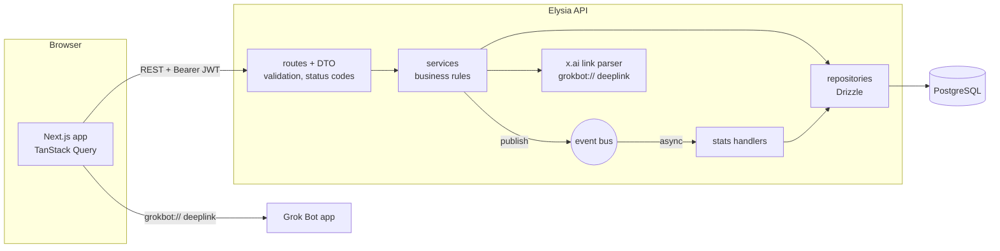
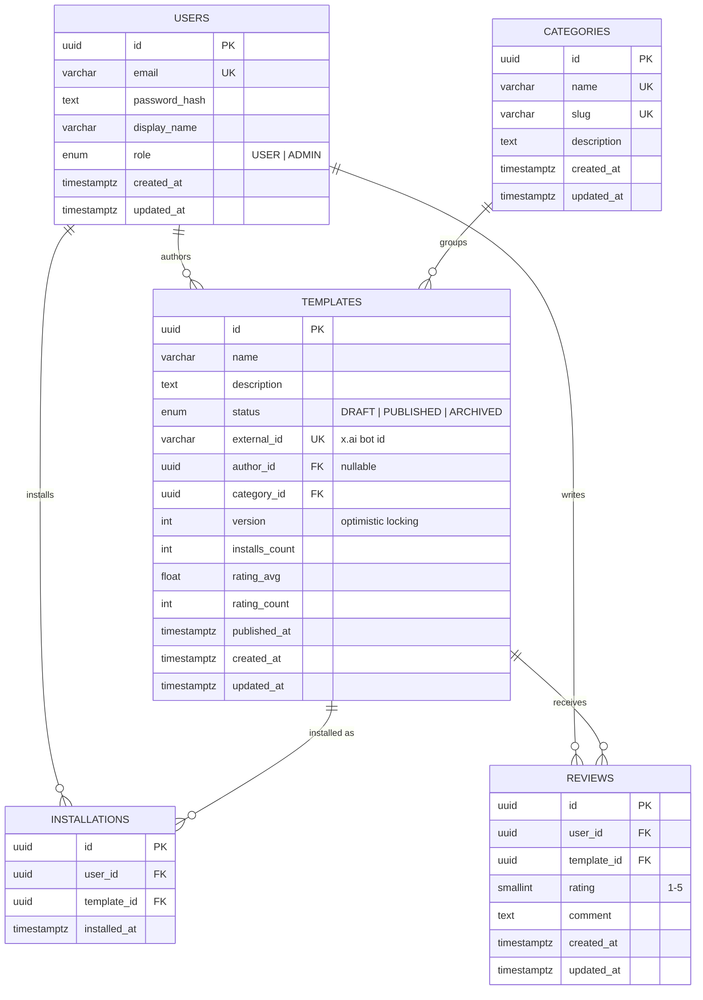

# Agentic Marketplace

A marketplace of agent templates for Grok Bot. Users list bots from x.ai by pasting their link (`https://x.ai/bot/<id>`), browse and search the catalog, install templates with one click (the same `grokbot://` deeplink as "Add to Grok Bot" on x.ai) and review the ones they use. Admins manage categories and user roles.

## Tech stack

| Layer | Technology |
|---|---|
| Backend | [Bun](https://bun.sh) 1.4, [ElysiaJS](https://elysiajs.com) (REST API), TypeBox validation |
| Database | PostgreSQL 17, [Drizzle ORM](https://orm.drizzle.team) on `Bun.sql`, drizzle-kit migrations |
| Auth | JWT (HS256, `jose`), passwords hashed with `Bun.password` (argon2id) |
| API docs | OpenAPI 3.1 via `@elysiajs/openapi` (Scalar UI at `/docs`) |
| Frontend | Next.js 16 (App Router), React 19, Tailwind CSS 4, TanStack Query |
| Infrastructure | Docker Compose (`db` + `api`), GitHub Actions CI |
| Tests | `bun test`: unit tests (services with fake repositories) and integration tests (HTTP → DB) |

## Repository layout

```
api/   REST API, database schema and migrations, tests, Dockerfile, docker-compose.yml
app/   Next.js frontend
.github/workflows/ci.yml   lint, build, migrations and tests for api; lint and build for app
```

## Running the project

Requirements: Docker with Docker Compose, Bun 1.4+.

### 1. API and database (Docker)

```bash
cd api
cp .env.example .env        # change passwords and JWT_SECRET before real use
docker compose up --build
```

- API: http://localhost:3001
- API docs (OpenAPI): http://localhost:3001/docs
- PostgreSQL: localhost:5432

On start the API container applies migrations, seeds categories (the ones used on the x.ai bot marketplace), the admin account (`ADMIN_EMAIL` / `ADMIN_PASSWORD` from `.env`) and 19 demo templates linked to real bots from https://x.ai/bot/marketplace, then starts the server. Demo templates belong to a "x.ai Marketplace" account that cannot log in and are seeded only once, so deleting one in the app is permanent.

### 2. Frontend

```bash
cd app
cp .env.example .env.local  # NEXT_PUBLIC_API_URL=http://localhost:3001
bun install
bun run dev
```

Open http://localhost:3000. Log in as the seeded admin, or create a regular account with "Sign up".

### Tests

```bash
cd api
docker compose up -d db     # creates marketplace_test on first start
bun install
bun test
```

Integration tests use only `TEST_DATABASE_URL`. For a database volume created before the test database existed, run `docker compose exec db createdb -U marketplace marketplace_test` once.

### Configuration

All configuration comes from environment variables (`api/.env`, `app/.env.local`); no secrets are stored in the repository. See `api/.env.example`:

| Variable | Purpose |
|---|---|
| `POSTGRES_USER`, `POSTGRES_PASSWORD`, `POSTGRES_DB` | database credentials (compose refuses to start without them) |
| `DATABASE_URL`, `TEST_DATABASE_URL` | connection strings for local dev and tests |
| `JWT_SECRET` (≥ 32 chars), `JWT_EXPIRES_IN` | token signing and lifetime; the API refuses to start without a secret |
| `ADMIN_EMAIL`, `ADMIN_PASSWORD` | initial admin created by the seed |
| `CORS_ORIGIN` | frontend origin allowed by CORS |

## Features

- **Accounts and roles:** registration, login, JWT bearer auth. `USER` and `ADMIN` roles; admins can promote or demote other users.
- **Templates:** create a draft from an x.ai bot link, edit, publish, archive and delete. The catalog has search, a category filter, sorting (newest, most installed, top rated, name) and pagination. Drafts are visible only to the author and admins.
- **Installations:** "Install in Grok Bot" records the installation and opens `grokbot://app/v1/bot-template?id=<id>`; uninstall.
- **Reviews:** 1–5 star rating with a comment. Authors can edit their own reviews; authors and admins can delete them.
- **Statistics:** install count and average rating are recalculated asynchronously by event handlers.
- **x.ai integration:** templates are linked to x.ai bots; the link is validated and the bot id is turned into the x.ai page link and the Grok Bot install deeplink.
- **Admin panel:** categories CRUD, users and roles.

### Business rules

1. Only `PUBLISHED` templates can be installed, and each user can install a template only once.
2. A review requires the template to be installed, cannot be written for your own template, and is limited to one per user and template.
3. Publishing requires a description of at least 20 characters.
4. Template edits use optimistic locking: saving with an outdated `version` returns 409.
5. A template with installations cannot be deleted, only archived. A category with templates cannot be deleted.
6. Only the author or an admin can modify a template; an admin cannot change their own role.
7. A template must point to a valid x.ai bot link, and each x.ai bot can be listed only once.

## Architecture



How a request flows, e.g. `POST /templates/:id/install`:

1. **Route** (`installation.routes.ts`): the `auth` guard reads the bearer token, verifies the JWT and loads the user (401 / 403); `params` are validated (`uuid`, otherwise 422).
2. **Service** (`installation.service.ts`): checks the business rules (template exists and is `PUBLISHED`, not installed yet) and throws `BusinessRuleError` (422) or `ConflictError` (409).
3. **Repository** (`installation.repository.ts`): inserts the row with Drizzle; unique constraints back up the rules at database level.
4. The service publishes `template.installed`; the response (DTO, 201) is sent immediately and the stats handler then updates `installs_count` asynchronously.
5. Any error is turned into `{ "error": { "code", "message", "details?" } }` with the right status by the global error handler.

Details: [`api/README.md`](api/README.md) (layers, events, auth, endpoints) and [`app/README.md`](app/README.md) (pages, client architecture).

## Data model



`installations` and `reviews` are unique per `(user_id, template_id)`.

## REST API

Interactive documentation with request/response schemas: **http://localhost:3001/docs** (OpenAPI JSON at `/docs/json`).

| Method | Path | Access | Success |
|---|---|---|---|
| POST | `/auth/register` | public | 201 `{ token, user }` |
| POST | `/auth/login` | public | 200 `{ token, user }` |
| GET | `/auth/me` | logged in | 200 user |
| GET | `/users?page&limit&q` | ADMIN | 200 page of users |
| PATCH | `/users/:id/role` | ADMIN | 200 user |
| GET | `/categories` · `/categories/:id` | public | 200 |
| POST | `/categories` | ADMIN | 201 |
| PATCH · DELETE | `/categories/:id` | ADMIN | 200 · 204 |
| GET | `/templates?page&limit&q&categoryId&sort` | public (published only) | 200 page |
| GET | `/templates/mine?status&…` | logged in | 200 page |
| GET | `/templates/:id` | public / author / ADMIN | 200 |
| POST | `/templates` (body `xUrl`: `https://x.ai/bot/<id>`) | logged in | 201 draft |
| PATCH | `/templates/:id` (body includes `version`) | author / ADMIN | 200 |
| POST | `/templates/:id/publish` · `/archive` | author / ADMIN | 200 |
| DELETE | `/templates/:id` | author / ADMIN | 204 |
| GET · POST · DELETE | `/templates/:id/install` | logged in | 200 · 201 · 204 |
| GET | `/installations/mine?page&limit` | logged in | 200 page |
| GET | `/templates/:id/reviews?page&limit` | public | 200 page |
| POST | `/templates/:id/reviews` | logged in | 201 |
| PATCH · DELETE | `/reviews/:id` | review author (DELETE also ADMIN) | 200 · 204 |

Error responses: 400 malformed body, 401 missing or invalid token, 403 role or ownership, 404 not found, 409 conflict (duplicate, outdated version, in use), 422 validation or business rule, 500 unexpected. Body: `{ "error": { "code": "VALIDATION_ERROR", "message": "…", "details": [{ "path": "/rating", "message": "…" }] } }`.

## Demo

Demo video (3 min): [`docs/demo.mp4`](docs/demo.mp4). Catalog, registration, installing a bot in Grok Bot, a review, publishing a template from an x.ai link, the admin panel and the API docs.
